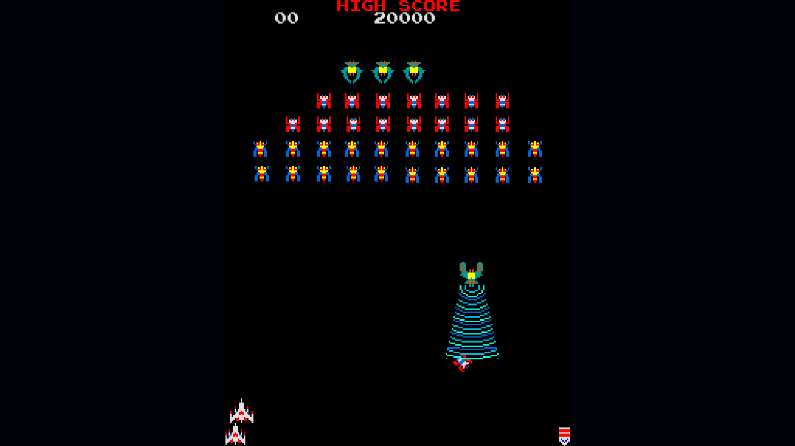
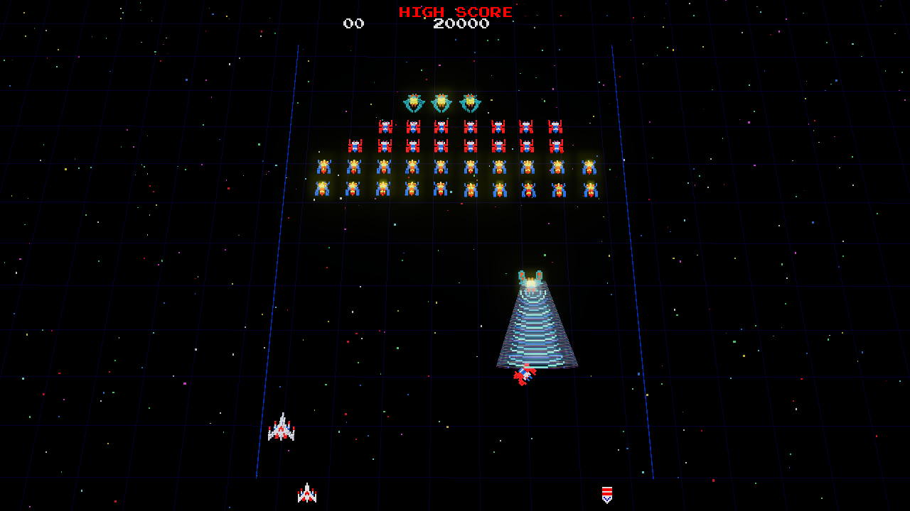
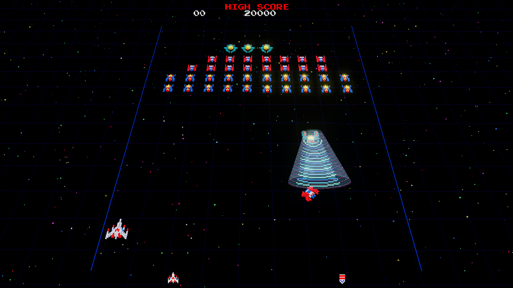
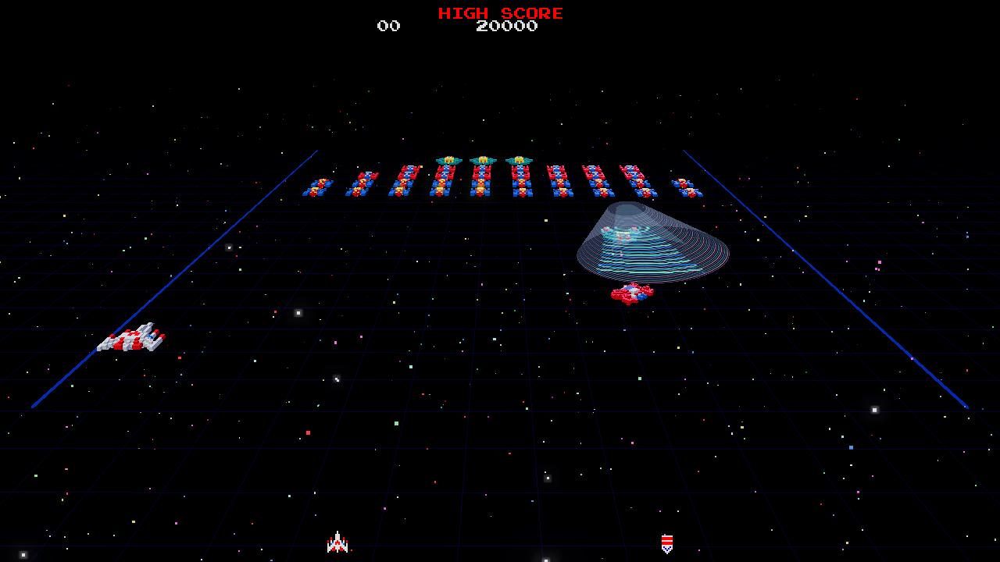

# Arcade ROM 3D Remaster — a Claude skill

**English** · [한국어](README.ko.md)

Give Claude a classic arcade ROM set that **you legally own** (a MAME `.zip` such as
`galaga.zip`), and this skill guides it to build a browser remaster where:

- the **original program ROMs run unmodified** on an emulated arcade board — enemy patterns,
  timing, scoring and music behave exactly like the cabinet;
- **only the picture is replaced** by a Three.js voxel renderer (3D models, lighting, bloom,
  volumetric effects, adjustable board tilt);
- the **original sound chip's performance is re-rendered in high quality** (band-limited
  wavetables, de-clicking, stereo, room reverb), with a one-key switch back to the raw cabinet sound.

Developer **GPT PARK** · [YouTube](https://www.youtube.com/@AIFACT-GPTPARK) · [Official site](https://gptparkai.com/)

> ⚠️ **No ROMs are included in this repository, and none will be downloaded by the skill.**
> Read [ROM usage notice](#rom-usage-notice) and [Disclaimer](#disclaimer) before use.

---

## Screenshots

The **same frozen frame** of a real game (a Boss Galaga's tractor beam capturing the fighter),
shown in the original 2D view and in 3D at three board-tilt presets:

| Original 2D (`V`) | 3D · tilt 20° (약하게) |
|---|---|
|  |  |
| **3D · tilt 40° (기본, default)** | **3D · tilt 68° (극적)** |
|  |  |

<sub>Galaga © Bandai Namco Entertainment Inc. Screenshots were captured from the program running
on the author's own ROM set and are shown only to document what the skill produces. The game's
graphics are not part of this repository's license, and no ROM data is included.</sub>

## Why emulate instead of re-creating?

A hand-made look-alike always plays slightly differently, and players notice. Running the real
code guarantees the feel of the original, while the 3D layer can be as ambitious as you like —
it only *reads* the board's video RAM, sprite RAM and latches, so it cannot break the game.

```
user's ROM zip ──► emulated board (CPU cores + custom chips, original code) ──► video RAM / sprite RAM ──► Three.js voxel renderer
                                                                     └──────► sound-chip registers ──► remaster synth ──► Web Audio
```

## What the skill makes Claude do

1. **Identify** the ROM set and its hardware (`scripts/rom_inspect.py`), then read the MAME
   driver source for the memory map, interrupts, video and sound hardware.
2. **Check the graphics decode** visually (`scripts/gfx_sheet.py` renders tile/sprite sheets).
3. **Bring up the board in 2D first** — boot to the game's own attract screen, verified by a
   text dump of the tilemap and a 2D reference renderer; then coin → start → score rises.
4. **Remaster the audio** — exact register emulation + high-quality synth + original-mode toggle,
   paced by the audio clock; verified numerically (levels, aliasing energy, stereo, stability).
5. **Build the Three.js renderer** — voxel models, pre-rotated sprite frames replaced by one
   model + heading (verified with a pixel-overlap test), tilemap text plane, effects triggered
   by board state, boot fast-forward, tilt presets with auto-fit, `V` key to compare with 2D.
6. **Verify live** with real key input and **report honestly** what is original, what is
   approximated, and what was not verified.

## Repository layout

```
SKILL.md                         the skill (workflow, ground rules, controls)
references/
  hardware-bringup.md            reading a MAME driver, scheduler, custom-chip HLE, verification ladder
  renderer-3d.md                 sprite→voxel, heading mapping + check, text plane, effects, camera fit
  audio-remaster.md              register emulation, remaster techniques, AudioWorklet, pacing, checks
  pitfalls.md                    real bugs hit while building the reference and how they were found
scripts/
  rom_inspect.py                 list a ROM zip (size, CRC32) and guess the game/board
  gfx_sheet.py                   decode graphics ROMs with a MAME-style layout into a PNG sheet
assets/galaga-reference/         complete working example (Galaga): index.html + js/ (no ROM data)
docs/screenshots/                README images (not covered by the MIT license)
THIRD_PARTY_NOTICES.md           MAME (BSD-3-Clause), three.js, screenshot/trademark notices
```

The reference implementation contains a verified Z80 core, a ZIP reader, the Galaga board
(3× Z80, Namco 06XX/51XX/54XX high-level emulation, WSG sound), the WSG remaster synth and the
full Three.js front end. Scripts need only Python 3 (no packages).

## Install

**Claude Code** (personal skill):

```bash
git clone https://github.com/muzbox1973/arcade-rom-3d-remaster ~/.claude/skills/arcade-rom-3d-remaster
```

On Windows the folder is `%USERPROFILE%\.claude\skills\arcade-rom-3d-remaster`.
Start a new session and the skill is available.

**Claude.ai**: download `arcade-rom-3d-remaster.skill` from the
[Releases](https://github.com/muzbox1973/arcade-rom-3d-remaster/releases) page and add it in
Settings → Capabilities → Skills.

## Use

Put your ROM zip somewhere Claude can read it and ask, for example:

- "Here is my `pacman.zip` — remaster it in 3D but keep the gameplay identical."
- "이 고전 MAME 롬파일을 3D 기술을 활용하여 리뉴얼해"

The result is a folder with `index.html`, `js/`, `rom/<set>.zip` (your file, not to be
shared) and `start.bat`. Run `start.bat` (or `python -m http.server`) and open the page.

Default controls of generated remasters:

| Key | Action |
|---|---|
| 5 / C | Insert coin |
| 1 / Enter, 2 | 1P / 2P start |
| ← → / A D | Move |
| Space / Z | Fire |
| P · M · O | Pause · Mute · Original/remastered sound |
| V · T | Original 2D ↔ 3D · Board tilt preset (top view → dramatic) |

## Limitations

- Bundled CPU core: **Z80**. Boards with 6502 / 6809 / 68000 etc. need a new core (the skill
  explains the interface), which takes considerably longer.
- Some boards use custom chips whose internal ROMs are **not** part of the game's ROM set
  (e.g. Namco 54XX explosion noise). Those parts are approximated from their command protocol,
  and the skill tells you so.
- Building a remaster for a new board is a long, multi-step task. Results depend on the game,
  and the skill reports what could not be verified (e.g. stages not reached in automated play,
  sound that was measured but not listened to).
- Only the Galaga reference has been built end to end so far.

## ROM usage notice

- **This repository contains no ROM images**, and the skill instructs Claude never to download,
  embed or redistribute ROM data. Generated remasters decode graphics, palettes and sound
  waveforms **at runtime** from the zip you supply.
- Arcade ROMs are copyrighted works of their respective owners. Use only ROM images you are
  legally entitled to use — for example dumps of boards you own, or sets obtained from a
  licensed distribution. Whether a backup/dump is lawful depends on the laws of your country.
- **Do not publish or distribute** a generated remaster together with ROM files or any
  ROM-derived assets (sprite sheets, extracted images, palettes, audio recordings).
- Game titles, logos and characters (e.g. *Galaga*, *Pac-Man*) are trademarks of their owners.
  If you share your own work publicly, do not present it as an official product, and consider
  removing trademarked names.

## Disclaimer

- This project is an independent, non-commercial tool. It is **not affiliated with, endorsed by,
  or sponsored by** Bandai Namco Entertainment, any other game publisher, Anthropic, or the MAME team.
- Hardware behaviour follows the [MAME](https://www.mamedev.org/) project's driver sources.
  The code here is an independent implementation, but its logic closely follows several
  BSD-3-Clause MAME files, whose copyright notices and license are retained in
  [THIRD_PARTY_NOTICES.md](THIRD_PARTY_NOTICES.md). MAME® is a registered trademark of
  Gregory Ember. Thanks to the MAME developers for decades of preservation work.
- The software is provided **"as is", without warranty of any kind** (see [LICENSE](LICENSE)).
  You are solely responsible for how you obtain and use ROM images and for complying with
  copyright, trademark and other laws that apply to you. The author accepts no liability for any
  damage, legal claim or loss arising from the use or misuse of this skill or of anything
  generated with it.
- Three.js (MIT) is loaded from a CDN by generated pages and is not redistributed here.

## License

[MIT](LICENSE) © 2026 muzbox (GPT PARK), except the third-party material listed in
[THIRD_PARTY_NOTICES.md](THIRD_PARTY_NOTICES.md). The license covers the code and documents in this
repository only; it grants no rights to any game, ROM, trademark or artwork
(including the game graphics visible in the screenshots).

---

Developer **GPT PARK**
- YouTube — https://www.youtube.com/@AIFACT-GPTPARK
- Official site — https://gptparkai.com/
